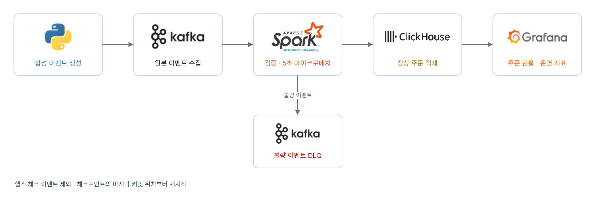
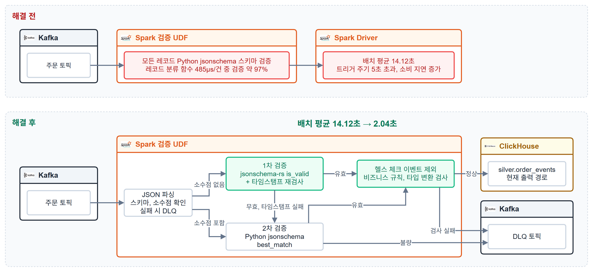
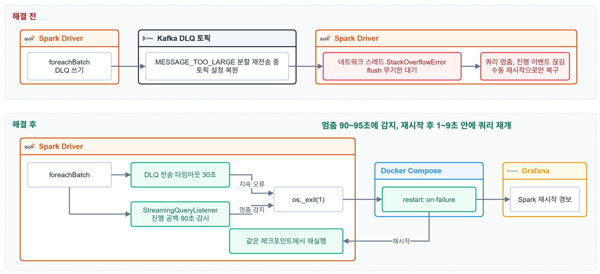
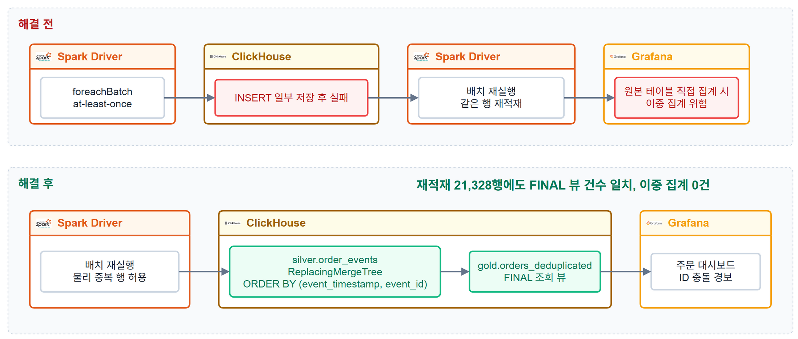
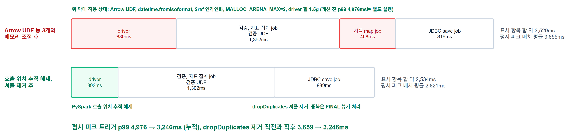

# 스트리밍 데이터 처리 파이프라인


<!-- 상태 완료, 적용 범위 v1, 로컬 Docker Compose 환경의 합성 주문 완료 이벤트 -->
주문 완료 이벤트를 Kafka → Spark Structured Streaming → ClickHouse로 처리하고 Grafana로 모니터링하는 로컬 스트리밍 파이프라인입니다. 5,000 EPS 지속 부하에서 E2E p95 7.30초, 적재 장애 재시도 후에도 주문 집계 일치를 확인했습니다.

## 프로젝트 개요

- 기간: 2026.11
- 입력량 변화와 적재 장애가 처리량, 지연, 데이터 정합성에 주는 영향을 측정하는 것이 목적
- 주문 완료 이벤트는 건수와 매출 합계로 대조가 쉽고 정상, 불량 이벤트를 함께 생성할 수 있어 입력으로 선정
- 5,000 EPS에서 이벤트 생성부터 적재까지 10초 이내, 장애와 스파이크에서도 유실, 중복 집계 없음이 목표
- 입력 데이터는 합성 주문 완료 이벤트, 헬스 체크, 불량 이벤트
- 지속 부하, 시간대별 부하 변동, 스파이크 후 회복, 적재 실패와 재시작을 검증

## 아키텍처



## 기술 스택

| 항목 | 내용 |
| --- | --- |
| 언어 | Python 3.12 |
| 이벤트 생성기 | Python, `confluent-kafka` 2.16.1, `uv` |
| 메시지 브로커 | Apache Kafka 4.4.0 |
| 스트림 처리 | Spark Structured Streaming 4.2.1 (PySpark) |
| 저장소 | ClickHouse 26.8 |
| 시각화 | Grafana 13.2 |
| 실행 환경 | Docker Compose, WSL2 (논리 CPU 8개, 메모리 상한 12GB) |

### 기술 선택 이유

- 10초 이내 처리, 장애와 스파이크에서도 유실, 중복 집계 없음을 기준으로 선택하고 근거는 시험으로 확인

- Apache Kafka는 처리 지연 시 이벤트를 보관하고 재시작 후 오프셋부터 재조회
  - RabbitMQ는 소비 시 메시지를 삭제해 재처리가 어려움
  - 스파이크 시 최대 백로그 218,867건 보관, 약 40~44초 만에 회복
- `confluent-kafka`는 공식 Python 클라이언트가 없어 선택
  - `librdkafka` 비동기 Producer로 배치 전송, 재시도, 건별 ACK 대기 회피
  - `msg.latency()`로 건별 ACK 지연 수집
- Spark Structured Streaming은 초 단위 목표에 5초 마이크로 배치로 충분
  - 체크포인트 오프셋 기준으로 실패 배치 재실행
  - `foreachBatch`로 정상 주문은 ClickHouse, 불량 이벤트는 DLQ로 분기
  - 60분 지속 부하 E2E p95 7.30초
- ClickHouse는 열 기반 저장으로 건수, 매출 집계 조회에 적합
  - `ReplacingMergeTree`, `FINAL` 뷰로 재시도 중복 제거
  - 중복 8,573행 발생에도 집계 3,825,832건이 정상 주문 수와 일치
- Grafana는 ClickHouse SQL을 직접 조회하고 5초 주기로 갱신
  - 대시보드, 경보 규칙을 파일로 프로비저닝해 `docker compose up`만으로 재구성

- 대안 비교는 [기술 선정 근거](docs/prd/overview.md#기술-선정-근거) 참고

## 기술 구현 및 개선

### 부하 재현과 성능 검증

- CSV 프로파일로 고정 부하, 단계적 증가, 스파이크, 시간대별 변동 재현 [부하 프로파일](docs/prd/06-load-profile.md)

| 시험 | 주요 결과 |
| --- | --- |
| **5,000 EPS 목표, 60분 지속 부하** | 평균 입력 **4,954 EPS**, 이벤트 생성부터 ClickHouse INSERT까지 **p95 7.30초** |
| **60분 시간대별 부하** | 11개 부하 구간 통과, 피크 평균 입력 **7,493 EPS**, 해당 구간 E2E **p99 6.98초** |
| **12,000 EPS 목표, 150초 스파이크** | 11월 24일 재측정에서 평균 입력 **11,951 EPS**, E2E **p99 9.33초**, 스파이크 종료 후 **2.5초**에 회복 |

- EPS는 전체 입력 이벤트의 초당 건수
- 측정 환경은 WSL2, 논리 CPU 8개, 메모리 상한 12GB
- 지속 부하 지연은 워밍업 2분과 VM 정지 영향 구간을 제외한 값. 정지 영향 구간에서는 48,249건이 10초 초과
- 시간대별 부하는 VM 정지가 관측되지 않은 실행 1회 기준
- [지속 부하 판정](docs/prd/overview.md), [시간대별 부하 원자료](docs/measurements/2026-11-24-spark-daily8.json), [스파이크 재측정 원자료](docs/measurements/2026-11-24-spark-spike3.json)

### 이벤트 검증과 DLQ 분기

- 헬스 체크 이벤트 제외
- 정상 주문은 ClickHouse `silver.order_events`에 적재
- 불량 이벤트는 오류 정보, 원본 Kafka 위치와 함께 DLQ로 전송
- [이벤트 계약과 샘플](contracts/README.md)

### 장애 복구

- 체크포인트의 마지막 커밋 위치부터 재조회, 미완료 배치 재실행
- 주문 집계는 재시도 중복을 제거한 조회 뷰 사용
- [스트림 처리 설계](docs/prd/03-stream-processing.md)

### 대시보드

- 주문 건수, 매출, 생성기 전송 지연, Kafka 백로그, Spark 배치 시간, 이벤트 적재 지연 표시
- [대시보드 설계](docs/prd/05-grafana-dashboard.md)
- 시간대별 부하 화면 [파이프라인 운영](images/captures/2026-11-24-spark-daily8/pipeline.png), [주문 현황](images/captures/2026-11-24-spark-daily8/orders.png)
- 스파이크 재측정 화면 [파이프라인 운영](images/captures/2026-11-24-spark-spike3/pipeline.png), [주문 현황](images/captures/2026-11-24-spark-spike3/orders.png)

## 주요 문제 해결

### 1. Spark 이벤트 검증 jsonschema-rs 2단계 전환: 배치 평균 14.12 → 2.04초

- **문제**: Python `jsonschema` 검증이 레코드 분류 비용의 약 97%를 차지해 5,000 EPS에서 배치 평균 14.12초로 트리거 5초 초과
- **해결**: Rust 기반 `jsonschema-rs` 1차, 기존 검증기 2차 구조로 판정 차이를 보완하며 검증 비용 축소
- **결과**: 배치 평균 14.12 → 2.04초, 트리거 5초 초과 배치 0개, 불량 데이터 정상 통과 0건

<details>
<summary>상세 보기</summary>

**아키텍처**



**문제 정의**

- 5,000 EPS 지속 부하에서 배치 평균 14.12초로 트리거 5초를 넘어 Kafka 소비 지연이 계속 증가
- 레코드 분류 함수 구간 측정 결과 485µs/건 중 Python `jsonschema` 스키마 검증이 약 97%를 차지
- cProfile 결과 레코드마다 하위 스키마 52곳에서 검증기 객체를 새로 만들고 `$ref` 14개를 다시 해석해 1건당 Python 함수 호출 약 2,333회 발생

**해결 과정**

- 스키마를 미리 컴파일하는 Rust 기반 `jsonschema-rs`를 같은 계약 스키마에 적용해 1.5µs/건 확인
- 다만 소수점 표기 정수 `15000.0`과 타임스탬프 연도 `0000`, 초 `60`을 유효로 판정해 그대로 교체하면 불량 데이터가 정상 주문으로 통과
- `jsonschema-rs` 1차, 기존 검증기 2차 구조로 구현해 1차 유효 판정만 신뢰하고, 1차 무효는 2차 `best_match`로 다시 판정해 DLQ 오류 코드, 경로, 메시지 유지
- `json.loads`의 `parse_float` 훅으로 소수점 숫자를 감지하면 1차를 건너뛰고, 1차 유효 레코드는 타임스탬프만 기존 형식 검사기로 재검사

**결과**

- 2단계 검증 유무만 다른 5,000 EPS 600초 부하에서 배치 평균 14.12 → 2.04초, 트리거 5초 초과 배치 43개 전부 → 120개 중 0개
- Kafka 대기 지연 배치별 p95 49~225초 → 약 4.8초, 입력 중단 후 약 12초 만에 지연 0
- 입력 358만 건이 생성기 종류별 건수와 정확히 일치하고, 두 검증기 대조 테스트에서 불량 데이터가 정상으로 통과한 사례 0건

- [검증 전후 측정](docs/prd/03-stream-processing.md#처리량-병목-분류-단계-계약-검증-2026-11-17), [지속 부하 재측정](docs/prd/03-stream-processing.md#2단-검증-적용-후-지속-부하-재측정-2026-11-17), [불량률별 분류 비용](docs/prd/03-stream-processing.md#불량률별-분류-비용-2026-11-26)

</details>

---

### 2. DLQ 쓰기 장애 Spark 쿼리 정지 자동 복구: 수동 재시작 → 약 100초 만에 자동 복구

- **문제**: DLQ 재전송 중 Kafka producer 네트워크 스레드가 `StackOverflowError`로 죽어 Spark 쿼리가 예외 없이 무기한 정지
- **해결**: `StreamingQueryListener` 진행 감시로 90초 공백 시 프로세스 종료, Docker Compose `restart: on-failure`로 같은 체크포인트에서 재실행
- **결과**: 수동 재시작 → 약 100초 만에 자동 복구, 장애 3종 주입 중 재시작 4회 모두 자동 복구

<details>
<summary>상세 보기</summary>

**아키텍처**



**문제 정의**

- DLQ 쓰기 실패 시 쿼리 실패와 재시작 동작을 검증하려고 DLQ 토픽 `max.message.bytes`를 100으로 낮춰 장애 주입
- 장애를 유지하면 120초 뒤 `TimeoutException`으로 정상 실패했지만, 브로커가 `MESSAGE_TOO_LARGE`로 거부해 producer가 배치를 나눠 재전송하는 도중 한도를 되돌리면 producer 네트워크 스레드가 `StackOverflowError`로 죽어 `flush`가 무기한 대기
- 예외 없이 멈춰 쿼리가 끝나지 않고 진행 이벤트와 지표 행도 끊겨, 장애를 해소한 뒤 3.8분이 지나도 풀리지 않아 수동 재시작으로만 복구

**해결 과정**

- 재전송 도중 한도를 되돌리면 3회 중 3회 멈춤이 재현되어 Kafka 클라이언트 내부 오류로 판단하고, 앱 안 재시도는 실패를 숨기므로 멈춤을 프로세스 종료로 바꾸는 방향 선택
- 배치가 멈추면 진행 이벤트도 오지 않아 리스너만으로는 감지할 수 없기 때문에, `StreamingQueryListener`는 진행 또는 유휴 이벤트 시각만 갱신하고 Driver 감시 스레드가 90초 공백이면 exit 1
- 멈춘 태스크는 `query.stop()`도 끝나지 않을 수 있어 `os._exit`로 즉시 종료하고, Docker Compose `restart: on-failure`로 같은 체크포인트에서 미완료 배치 재실행
- `on-failure:5`는 재시작 횟수가 컨테이너 수명 동안 누적되어 상한을 제거하고, DLQ 전송 타임아웃을 120초에서 30초로 줄여 장애 유지 시 실패 감지 단축

**결과**

- 2,000 EPS 660초 부하 중 워커 정지, DLQ 장애 유지, 재전송 도중 장애 해소 3종을 주입해 재시작 4회 모두 사람 개입 없이 복구
- 감시 도입 후 `StackOverflowError` 멈춤 4회 모두 90~95초에 감지되어 종료되고, 재시작 후 1~9초 안에 쿼리 재개
- 생성기 정상 주문 수와 적재 고유 건수가 1,122,310건으로 일치하고, DLQ는 11-18 실행의 키 대조에서 누락 0건

- [재검증 결과](docs/prd/04-clickhouse-storage.md#멈춤-감시자동-재시작-재검증-상한-없는-재시작-2026-11-26), [측정 원자료](docs/measurements/2026-11-26-spark-stall-recovery.json), [운영 화면](images/captures/2026-11-26-spark-stall-recovery/pipeline.png)

</details>

---

### 3. ClickHouse 재적재 중복 ReplacingMergeTree와 FINAL 뷰 제거: 재적재 21,328행에도 이중 집계 0건

- **문제**: `foreachBatch` at-least-once 쓰기로 적재 실패 후 재실행 시 이미 저장된 주문이 다시 적재되어 이중 집계 위험
- **해결**: `ReplacingMergeTree` `(event_timestamp, event_id)` 키로 중복을 병합하고, 병합 전 조회는 `FINAL` 뷰로 처리
- **결과**: 재적재 21,328행에도 `FINAL` 뷰 건수가 생성기 정상 주문 수와 일치해 이중 집계 0건

<details>
<summary>상세 보기</summary>

**아키텍처**



**문제 정의**

- `foreachBatch`는 at-least-once 쓰기 보장이라, 배치가 여러 JDBC INSERT로 나뉘어 일부가 이미 저장된 상태에서 실패하면 재실행 시 저장된 행도 다시 적재될 것으로 예상
- ClickHouse MergeTree 계열은 기본 키가 고유성을 보장하지 않아 중복 INSERT를 거부하지 못함
- 원본 테이블을 그대로 집계하면 재적재된 주문이 이중 집계되어 주문 수와 매출이 부풀려질 위험 존재

**해결 과정**

- 배치 내 `dropDuplicates`는 이미 ClickHouse에 저장된 행과의 중복을 알 수 없어, 적재 중복은 허용하고 ClickHouse에서 제거하도록 설계
- 같은 정렬 키의 행을 병합하는 `ReplacingMergeTree`를 `(event_timestamp, event_id)` 키로 적용하고, 적재 시각처럼 재실행마다 바뀌는 값은 키에서 제외
- 방금 적재된 데이터는 아직 병합 전이라 Grafana 조회 시 중복이 보일 수 있어 `FINAL` 조회 뷰 `gold.orders_deduplicated`를 사용하고, `event_timestamp`를 키 앞에 둬 15분 범위 조회 p95 336ms 유지
- 같은 `event_id`에 다른 `event_timestamp`가 들어오면 병합되지 않으므로 최근 1시간 범위의 Grafana ID 충돌 경보로 드러냄

**결과**

- 5,000 EPS 900초 부하 중 저장 후 오류(code 395)와 저장 전 권한 거부(code 497) 주입 시 두 적재 실패 모두 같은 배치 재실행
- 저장 후 오류에서 같은 주문 21,328행이 다시 적재됐지만 `FINAL` 뷰 건수가 생성기 정상 주문 수 3,824,505건과 일치해 이중 집계 0건
- 같은 `event_id`에 다른 `event_timestamp`를 가진 시험 행 2개 INSERT 시 1분 주기 평가에서 Grafana ID 충돌 경보 발생

- [장애 주입 결과](docs/prd/04-clickhouse-storage.md#장애-주입-측정-결과-2026-11-18), [재실행 결과](docs/prd/04-clickhouse-storage.md#장애-주입-재실행-현재-구성-2026-11-26), [측정 원자료](docs/measurements/2026-11-26-clickhouse-fault-injection.json)

</details>

---

### 4. 평시 피크 Spark 배치 비용 분해 최적화: 트리거 p99 4,976 → 3,246ms

- **문제**: 평시 피크 7,500 EPS에서 트리거 시간 p99 4,976ms로 목표 3,500ms 초과
- **해결**: 비용 분해 후 Arrow UDF 전환, PySpark 호출 위치 추적 해제, 배치 내 `dropDuplicates` 셔플 제거
- **결과**: 트리거 p99 4,976 → 3,246ms, 평균 3,542 → 2,633ms로 목표 첫 충족

<details>
<summary>상세 보기</summary>

**아키텍처**



**문제 정의**

- 평시 피크 7,500 EPS에서 5초 트리거마다 약 37,000건을 처리하는 배치의 트리거 시간 p99가 4,976ms로 목표 3,500ms 초과
- p99가 트리거 5초에 24ms 차이로 근접해, 부하가 조금만 늘어도 배치가 주기를 넘어 Kafka 소비 지연이 쌓일 위험
- 평시 피크 배치의 평균 트리거 시간도 3,542ms로 목표를 넘어, 일부 느린 배치가 아니라 배치마다 드는 처리 비용 전체를 줄여야 한다고 판단

**해결 과정**

- 입력 약 54,000건 배치의 `foreachBatch` 평균 5,003ms를 단계별로 나눠, 검증과 지표 집계 2,816ms 중 검증 UDF 약 1,340ms가 가장 큰 단일 비용임을 확인
- 벤치마크 중앙값이 5% 이상 줄어든 변경만 채택해 Arrow UDF 전환, `datetime.fromisoformat` 전환, `$ref` 인라인화를 적용
- Arrow UDF 적용 뒤 메모리가 `mem_limit` 3g에 닿아 `MALLOC_ARENA_MAX=2`와 driver 힙 1.5g로 낮추고, GC 정지는 느린 배치 시간의 약 3%라 원인에서 제외
- 그래도 p99가 4.4~4.7초로 남아 driver 시간 약 880ms를 추적하니 PySpark가 함수 호출마다 호출 위치를 수집하며 py4j 왕복이 쌓여, `spark.python.sql.dataFrameDebugging.enabled=false`로 끄고 배치당 약 256ms 감소
- 남은 초과분 159ms보다 큰 배치 내 `dropDuplicates` 셔플(336~375ms)을 제거하고, 중복은 3번의 `ReplacingMergeTree`와 `FINAL` 뷰가 합치므로 ClickHouse로 일원화

**결과**

| 시점 | 평시 피크 트리거 평균 | 평시 피크 트리거 p99 |
| --- | ---: | ---: |
| 개선 전 | 3,542ms | 4,976ms |
| Arrow UDF 등 3개와 메모리 조정 후 | 3,498ms | 4,687ms |
| 호출 위치 추적 해제 후 | 2,879ms | 3,659ms |
| `dropDuplicates` 제거 후 | 2,633ms | 3,246ms (목표 3,500ms 첫 충족) |
| 60분 시간대별 부하 2회 | 2,265~2,368ms | 2,848~3,485ms, 11개 구간 모두 통과 |

- 각 행은 서로 다른 실행의 관측값이며, 메모리 조정으로 Spark `memory.peak`가 3g 한도 도달에서 약 2.6GiB로 감소
- 단일 변경 효과는 `dropDuplicates` 제거 직전과 직후 3,659 → 3,246ms이고, 제거 후에도 silver 물리 행, 고유 `event_id`, `FINAL` 행이 3,180,849건으로 일치

- [비용 분해](docs/prd/03-stream-processing.md#비용-분해-2026-11-20), [메모리 조정](docs/prd/03-stream-processing.md#jvm-튜닝-결과-2026-11-20), [호출 위치 추적 해제 검증](docs/prd/03-stream-processing.md#s5a-적용-steady-검증-2026-11-23), [dropDuplicates 제거 검증](docs/prd/03-stream-processing.md#d1-적용-steady-검증-2026-11-23), [60분 재실행](docs/prd/03-stream-processing.md#daily-재실행-호스트-성능-카운터-동시-수집-2026-11-26)

</details>

## 실행 방법

- 사전 요구사항은 Docker, Docker Compose, Python 3.12, `uv`

```bash
cp -n .env.example .env
```

- `.env`에 로컬 비밀번호 `CLICKHOUSE_PASSWORD`, `CLICKHOUSE_SPARK_PASSWORD`, `CLICKHOUSE_GENERATOR_PASSWORD`, `CLICKHOUSE_GRAFANA_PASSWORD`, `CLICKHOUSE_MONITOR_PASSWORD`, `GRAFANA_ADMIN_PASSWORD` 설정

```bash
docker compose up -d --build
docker compose ps -a
```

- `kafka-init`, `clickhouse-init`이 `Exited (0)`이고 Spark 실행 중이면 생성기 시작

```bash
cd apps/log_generator
uv sync
PRODUCER_OUTPUT=kafka PRODUCER_EPS=1000 PRODUCER_MAX_EVENTS=30000 uv run log-generator
```

- Grafana는 `http://localhost:3000`에서 `.env`의 관리자 계정으로 로그인
- **주문 현황**, **파이프라인 운영** 대시보드에서 적재, 처리 지표 확인
- 종료는 저장소 루트에서 `docker compose down`
- 상세 절차는 [로컬 실행과 장애 확인 절차](docs/runbooks/local-development.md) 참고

## 폴더 구조

```text
.
├── apps/
│   ├── log_generator/   # 합성 이벤트 생성기와 부하 프로파일 profiles/*.csv
│   └── streaming/       # Spark Structured Streaming 검증, 적재 작업
├── contracts/           # 이벤트 JSON Schema와 샘플
├── infra/
│   ├── kafka/           # 토픽 초기화
│   ├── clickhouse/      # 스키마와 초기화 스크립트
│   └── grafana/         # 데이터 소스, 대시보드, 경보 프로비저닝
├── tests/integration/   # Kafka 수집 통합 테스트
├── docs/
│   ├── prd/             # 단계별 요구사항과 검증 기록
│   ├── measurements/    # 측정 JSON 원자료와 진단 기록
│   └── runbooks/        # 로컬 실행 절차
├── images/              # 아키텍처와 Grafana 캡처
└── compose.yaml
```

## 한계

### 환경, 측정

- WSL2 단일 VM, Docker Compose 단일 노드 기준이라 브로커 다중화, 클러스터 확장, 노드 장애는 미검증
- 지속 부하 판정에서 VM 정지 구간은 제외했고, 해당 구간에서 48,249건이 10초 초과
- 시간대별 부하는 VM 정지가 없던 실행 기준
- 지연은 ClickHouse `ingested_at` 적재 시각까지 측정했고, 대시보드 조회 가능 시점은 미측정
- 생성기는 프로세스 1개당 Python CPU 한계로 약 10,000 EPS라 12,000 EPS 스파이크는 2개 프로세스로 생성

### 데이터 정합성

- `foreachBatch`는 at-least-once 전달이라 물리 중복 행은 남고 `FINAL` 조회 뷰로 중복 제거
- 정상 적재와 DLQ 기록이 원자적이지 않아 배치 재시도 시 DLQ 메시지 중복 가능
- Producer 멱등성은 클라이언트 재시도에만 적용되어 생성기 프로세스 재실행 시 exactly-once 미보장

### 기능 범위

- DLQ 자동 재처리와 수정 데이터 재투입 기능 없음
- 주문 완료 단일 이벤트 도메인만 다루며 다중 이벤트 도메인은 v2 범위
- 합성 데이터만 사용해 실제 회원 데이터 연동, 파생 컬럼, 외부 데이터 조인 미적용
